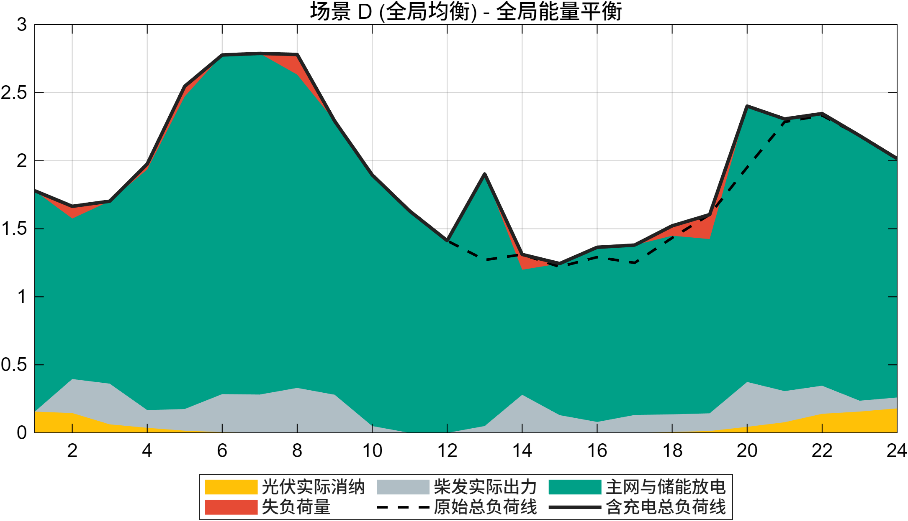

# IEEE 33-bus typhoon case

This case models 24 one-hour periods beginning at 12:00. It combines a modified radial feeder, a 25-node road network, two mobile batteries, three EV fleets, local PV and diesel generators. The typhoon scenario changes the available lines in several stages.

## Methods and baselines

The topology manager generates tie-switch and vehicle-location plans. NSGA-III then searches a common hourly price signal with the plans held fixed. The Python actors use observed state and local electrical-area information to respond. The MATLAB dispatch layer decides which requests can be executed, subject to feeder constraints.

- **S1** uses the damaged topology without tie-line restoration or storage requests.
- **S2** enables the tie-line restoration plan.
- **S3** enables storage responses under a fixed time-of-use tariff.
- **S4 A–D** select minimum unserved energy, minimum incentive cost, minimum equivalent outage, and a balanced point from the saved front.

Diesel generation, deployed MESS and plugged-in EVs are eligible island voltage references in this case. Charging and discharge deviations are handled with asymmetric penalties.

## Saved results

The balanced point recorded in the optimization archive has **0.718 MWh** unserved, **CNY 4,943** in incentives, and **25.63 equivalent critical-load outage minutes**. See [the saved optimization archive](Data/Optimization_Result.mat) and [detailed balanced replay](Data/Detailed_Simulation_Report_S4_D.txt). The optimization archive records the population evaluation. The benchmark and detailed reports record the individual replay. Launch checks for both cases and seven-strategy replays were run on the publication snapshot.



## Run

1. Install MATLAB, Optimization Toolbox, Statistics and Machine Learning Toolbox, and [YALMIP](https://yalmip.github.io/). Install Python packages using the [root requirements](../requirements.txt). The published case used MATLAB R2025b and Python 3.11.
2. Open MATLAB in this case directory. Set local paths and choose the solver.

```matlab
setenv('YALMIP_ROOT', '/path/to/YALMIP');
pyenv('Version', '/path/to/python', 'ExecutionMode', 'OutOfProcess');
setenv('STACKELBERG_SOLVER', 'intlinprog');
addpath(fullfile(pwd, 'Data'));
cd('MATLAB_Layer');
```

3. Run `Quick_Plot` to replay the included prices and refresh their figures or `Benchmark_Runner` to evaluate all seven strategies. Run `Generate_Text_Report` for the detailed dispatch report. To search new prices, run `Main_NSGA3`. It rebuilds the topology and vehicle plans and writes a new result to `Data/`.

The bundled weights load automatically. To use a replacement team, set `STACKELBERG_TEAM_CHECKPOINT` to its absolute path before launching Python. Run the case in a separate copy to preserve saved outputs. `generate_data` regenerates scenario inputs.

## Files

- `MATLAB_Layer/` contains topology, traffic, dispatch, price search and reporting code.
- `Python_Layer/` contains agent training, inference, the EV availability model and model weights.
- `Data/` contains the feeder, scenario, dispatch plan, price archive, figures and reports.
