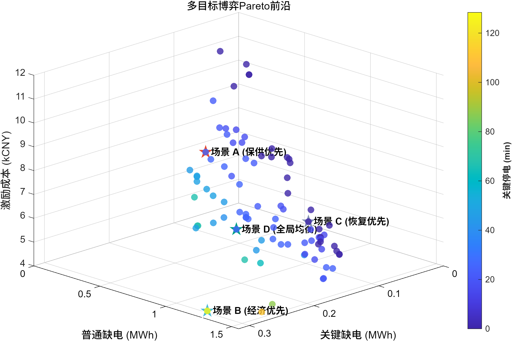

# Post-Disaster Grid Restoration

**Undergraduate thesis project · Power systems, optimization, and multi-agent learning**

How can a distribution-system operator use electricity prices to mobilize independently controlled storage after a storm? This MATLAB/Python simulator evaluates the trade-offs among unserved energy, incentive payments, and critical-load continuity as feeder connectivity changes.

## Two case studies

| Case | Scenario | Saved balanced solution |
| --- | --- | --- |
| [IEEE 33-bus](IEEE-33-Bus/) | 24-hour typhoon scenario with a 25-node road network | 0.718 MWh unserved · CNY 4,943 · 25.63 equivalent outage minutes |
| [IEEE 69-bus](IEEE-69-Bus/) | 24-hour cold-snap scenario with a 36-node road network | 6.437 MWh unserved · CNY 4,995 · 1,028.31 equivalent outage minutes |

Each row describes its own simulated network. Equivalent outage minutes are summed across critical loads. These are archived optimization results for the stated scenarios.

## How it works

1. **Restoration plan.** MATLAB builds hourly connected components from the outage schedule, closes feasible tie switches without forming loops, and assigns two mobile energy storage systems (MESS) using island power deficits and road travel times.
2. **Price search.** NSGA-III proposes a 24-hour electricity price schedule. The restoration plan is held fixed across candidate prices.
3. **Resource response.** Five pretrained MADDPG actors (two MESS and three EV fleets) request charging or discharging. The attention mask limits neighbor input to available agents in the same electrical area. The training setup models a conservative EV plug-in window.
4. **Physical dispatch.** MATLAB solves an hourly LinDistFlow-based dispatch model with YALMIP. It evaluates service restoration and voltage using the power actually delivered, updates battery state of charge, and sends the updated state to the next hour. The candidate receives three objectives after the 24-hour roll-out.

My implementation connects the transport and feeder models, develops and trains the resource policies, and couples batched Python inference to hourly MATLAB dispatch and price search. The NSGA-III selection routines are adapted from [Yarpiz YPEA126](https://github.com/smkalami/ypea126-nsga3).

## Run a case

Choose one case and follow its setup guide. Each directory includes its own inputs, optimization and reporting entry points, and pretrained actor bundle. The default settings use MATLAB Optimization Toolbox solvers. YALMIP and a MATLAB-compatible Python environment with NumPy and PyTorch are required. Start a fresh MATLAB session when switching cases.

The feeders are based on standard test systems, with synthetic hazard schedules, DER placement, load and solar profiles, and road networks. This is an hourly simulation study. Saved results use their respective scenario and solver settings.

[Third-party notices](THIRD_PARTY_NOTICES.md)
